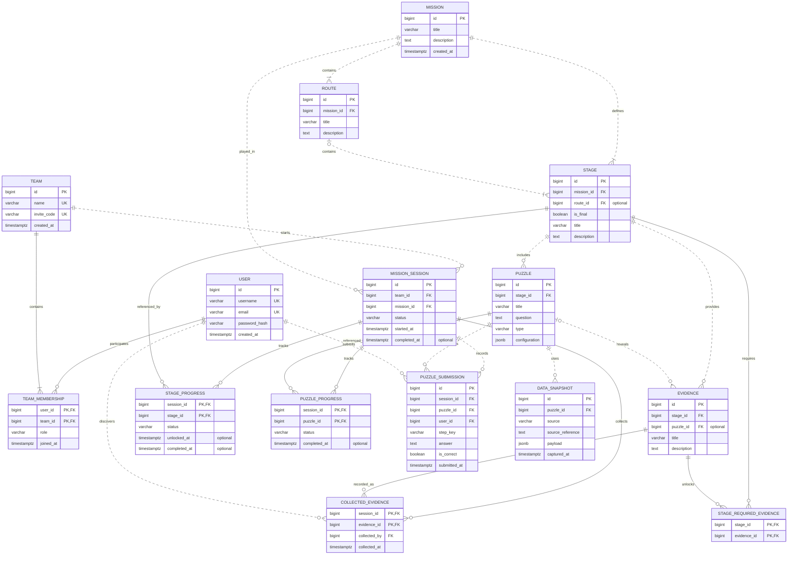

# EscapeHub - Μοντέλο δεδομένων (US-12)

## 1. Σκοπός

Σκοπός του μοντέλου δεδομένων είναι η περιγραφή των βασικών
οντοτήτων του EscapeHub, των χαρακτηριστικών τους και των
σχέσεων μεταξύ τους, ώστε να υπάρχει μια κοινή βάση για την
υλοποίηση της αποθήκευσης δεδομένων σε PostgreSQL.

Το μοντέλο διαχωρίζει τη δομή μιας αποστολής από την πρόοδο
κάθε ομάδας, επιτρέποντας σε διαφορετικές ομάδες να συμμετέχουν
στην ίδια αποστολή ανεξάρτητα η μία από την άλλη.

## 2. Διάγραμμα οντοτήτων και σχέσεων (ERD)

**Υπόμνημα:**

- PK: Primary Key (πρωτεύον κλειδί).
- FK: Foreign Key (ξένο κλειδί).
- UK: Unique Key (μοναδική τιμή).
- optional: Προαιρετικό πεδίο.
- Ξένο κλειδί (FK) που είναι και Πρωτεύον κλειδί (PK) → συνεχόμενη γραμμή.
- Ξένο κλειδί (FK) που δεν είναι και Πρωτεύον κλειδί (PK) → διακεκομμένη γραμμή.

## 3. Περιγραφή οντοτήτων

### 3.1 Χρήστες και ομάδες

| Οντότητα | Περιγραφή |
| --- | --- |
| USER | Αποθηκεύει τα στοιχεία του λογαριασμού κάθε παίκτη. |
| TEAM | Αντιπροσωπεύει μια ομάδα παικτών με μοναδικό κωδικό πρόσκλησης. |
| TEAM_MEMBERSHIP | Συνδέει τους χρήστες με τις ομάδες και καθορίζει τον ρόλο κάθε μέλους. |

### 3.2 Δομή αποστολής

| Οντότητα | Περιγραφή |
| --- | --- |
| MISSION | Περιγράφει μια αποστολή του παιχνιδιού. |
| ROUTE | Αντιπροσωπεύει μια διαδρομή διερεύνησης μέσα σε μια αποστολή. |
| STAGE | Περιγράφει ένα στάδιο της αποστολής. |
| PUZZLE | Περιέχει την εκφώνηση, τον τύπο και τους κανόνες επίλυσης ενός γρίφου. |
| EVIDENCE | Αντιπροσωπεύει ένα στοιχείο που μπορεί να ανακαλυφθεί κατά τη διάρκεια της αποστολής. |
| STAGE_REQUIRED_EVIDENCE | Καθορίζει τα στοιχεία που απαιτούνται για το ξεκλείδωμα ενός σταδίου. |
| DATA_SNAPSHOT | Διατηρεί ένα σταθερό αντίγραφο δεδομένων από εξωτερικές πηγές. |

### 3.3 Συνεδρία και πρόοδος

| Οντότητα | Περιγραφή |
| --- | --- |
| MISSION_SESSION | Αντιπροσωπεύει τη συμμετοχή μιας ομάδας σε μια συγκεκριμένη εκτέλεση αποστολής. |
| STAGE_PROGRESS | Καταγράφει την κατάσταση κάθε σταδίου ανά συνεδρία. |
| PUZZLE_PROGRESS | Καταγράφει την πρόοδο επίλυσης των γρίφων. |
| COLLECTED_EVIDENCE | Αποθηκεύει τα στοιχεία που έχουν συλλέξει τα μέλη μιας ομάδας κατά τη συνεδρία. |
| PUZZLE_SUBMISSION | Καταγράφει τις υποβολές απαντήσεων των παικτών. |

## 4. Κανόνες και περιορισμοί

### 4.1 Χρήστες και ομάδες

- Το username και το email κάθε χρήστη πρέπει να είναι μοναδικά.
- Οι κωδικοί πρόσβασης αποθηκεύονται σε μορφή hash.
- Κάθε ομάδα διαθέτει μοναδικό κωδικό πρόσκλησης.
- Κάθε ομάδα έχει έναν ιδιοκτήτη και μπορεί να έχει επιπλέον μέλη.
- Ένας χρήστης δεν μπορεί να συμμετέχει δύο φορές στην ίδια ομάδα.

### 4.2 Αποστολές και στάδια

- Κάθε διαδρομή ανήκει σε μία αποστολή.
- Το τελικό στάδιο μπορεί να είναι κοινό για όλες τις διαδρομές.
- Ένα στάδιο ξεκλειδώνεται όταν έχουν συλλεχθεί όλα τα απαιτούμενα στοιχεία.
- Οι προϋποθέσεις ξεκλειδώματος δεν πρέπει να δημιουργούν κυκλικές εξαρτήσεις.
- Μόνο το κοινό τελικό στάδιο μπορεί να μην ανήκει σε κάποια διαδρομή.
- Κάθε στάδιο πρέπει να ανήκει στην ίδια αποστολή με τη διαδρομή του, εφόσον υπάρχει.

### 4.3 Πρόοδος και συλλογή στοιχείων

- Κάθε ομάδα έχει ανεξάρτητη πρόοδο.
- Κάθε ομάδα μπορεί να έχει το πολύ μία ενεργή συνεδρία ανά αποστολή.
- Η πρόοδος αποθηκεύεται ώστε οι παίκτες να μπορούν να συνεχίσουν αργότερα.
- Κάθε στοιχείο καταγράφεται μόνο μία φορά ανά συνεδρία.
- Πρόσβαση στην πρόοδο έχουν μόνο τα εξουσιοδοτημένα μέλη της ομάδας.
- Οι ταυτόχρονες ενέργειες των παικτών δεν πρέπει να προκαλούν απώλεια δεδομένων.

### 4.4 Γρίφοι και εξωτερικά δεδομένα

- Οι απαντήσεις ελέγχονται στον εξυπηρετητή.
- Οι ακολουθιακοί γρίφοι απαιτούν συγκεκριμένη σειρά ενεργειών.
- Οι συνεργατικοί γρίφοι απαιτούν συμμετοχή τουλάχιστον δύο διαφορετικών παικτών.
- Τα στιγμιότυπα εξωτερικών δεδομένων παραμένουν σταθερά κατά τη διάρκεια της αποστολής.
- Ένας γρίφος μπορεί να ολοκληρωθεί χωρίς να αποκαλύψει κάποιο στοιχείο.
- Ένα στοιχείο μπορεί να ανακαλυφθεί ανεξάρτητα από την επίλυση ενός γρίφου.

## 5. Σύνθετα πρωτεύοντα κλειδιά

| Οντότητα | Σύνθετο κλειδί | Σκοπός |
| --- | --- | --- |
| TEAM_MEMBERSHIP | user_id, team_id | Αποφυγή διπλής συμμετοχής στην ίδια ομάδα. |
| STAGE_PROGRESS | session_id, stage_id | Μία εγγραφή προόδου ανά στάδιο και συνεδρία. |
| PUZZLE_PROGRESS | session_id, puzzle_id | Μία εγγραφή προόδου ανά γρίφο και συνεδρία. |
| COLLECTED_EVIDENCE | session_id, evidence_id | Αποφυγή διπλής καταγραφής ενός στοιχείου. |
| STAGE_REQUIRED_EVIDENCE | stage_id, evidence_id | Αποφυγή διπλών προϋποθέσεων ξεκλειδώματος. |

## 6. Παράδειγμα λειτουργίας

Έστω ότι δύο διαφορετικές ομάδες ξεκινούν την αποστολή
Villa Diodati. Για κάθε ομάδα δημιουργείται μια ξεχωριστή
εγγραφή στο MISSION_SESSION.

Όταν ένας παίκτης της πρώτης ομάδας λύσει έναν γρίφο,
ενημερώνεται το PUZZLE_PROGRESS της συγκεκριμένης συνεδρίας.

Εάν από την επίλυση του γρίφου προκύψει ένα νέο στοιχείο,
αυτό καταγράφεται στο COLLECTED_EVIDENCE και γίνεται
διαθέσιμο στα υπόλοιπα μέλη της ομάδας.

Όταν συγκεντρωθούν όλα τα απαιτούμενα στοιχεία για το
τελικό στάδιο, ενημερώνεται το STAGE_PROGRESS και το
στάδιο ξεκλειδώνεται.

Σε όλη αυτή τη διαδικασία, η πρόοδος της δεύτερης ομάδας
παραμένει ανεπηρέαστη.

## 7. Έλεγχοι και έγκριση

Κατά την υλοποίηση του μοντέλου δεδομένων θα πρέπει να
ελεγχθούν τα εξής:

- Η ανεξαρτησία της προόδου μεταξύ διαφορετικών ομάδων.
- Η σωστή αποθήκευση και ανάκτηση της προόδου.
- Η αποτροπή μη εξουσιοδοτημένης πρόσβασης.
- Το σωστό ξεκλείδωμα των σταδίων.
- Η ταυτόχρονη συλλογή στοιχείων χωρίς απώλεια δεδομένων.
- Η σωστή λειτουργία των ακολουθιακών και συνεργατικών γρίφων.
- Η διατήρηση των στιγμιότυπων εξωτερικών δεδομένων.

Το μοντέλο αποτελεί πρόταση σχεδιασμού και υπόκειται
σε έλεγχο και έγκριση από την ομάδα ανάπτυξης.